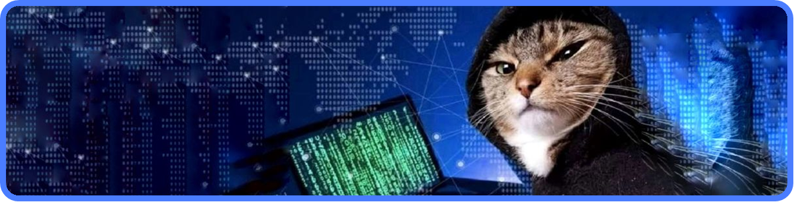
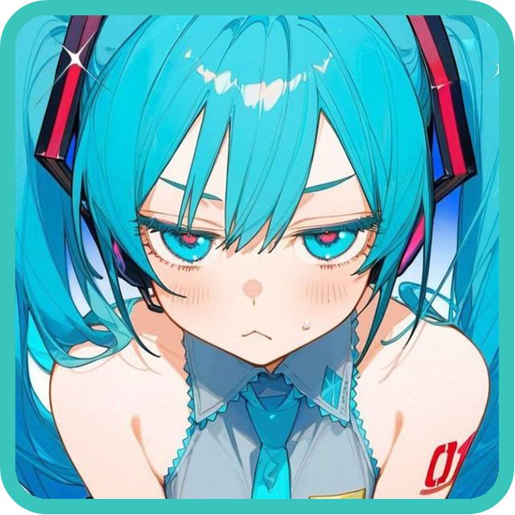
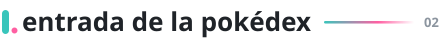
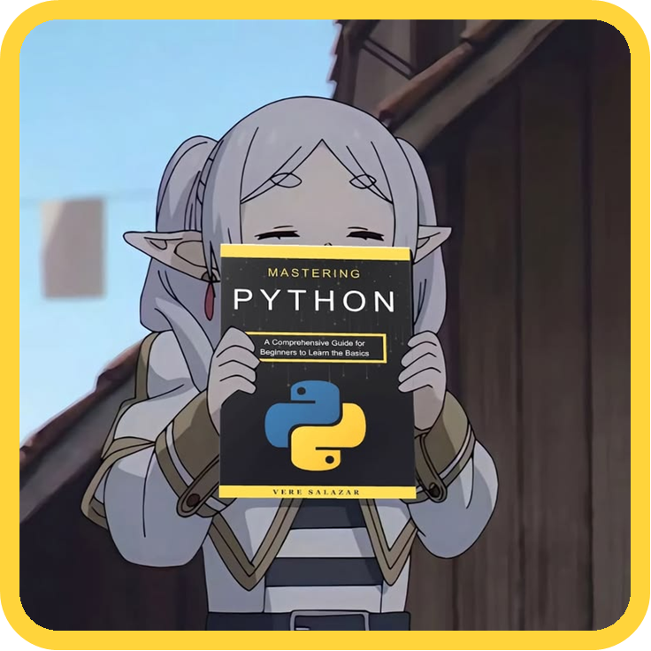
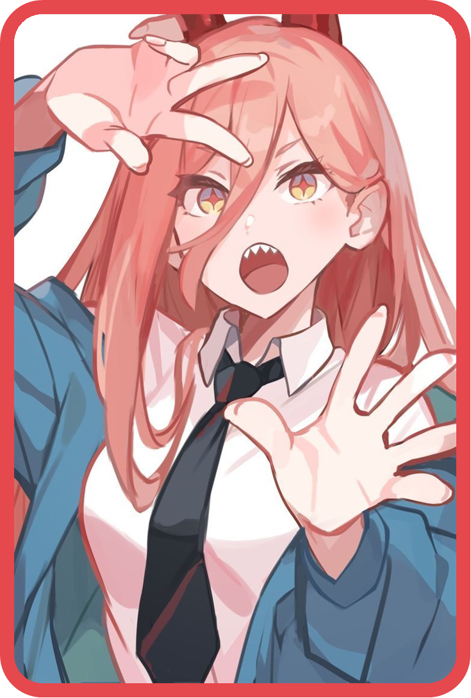
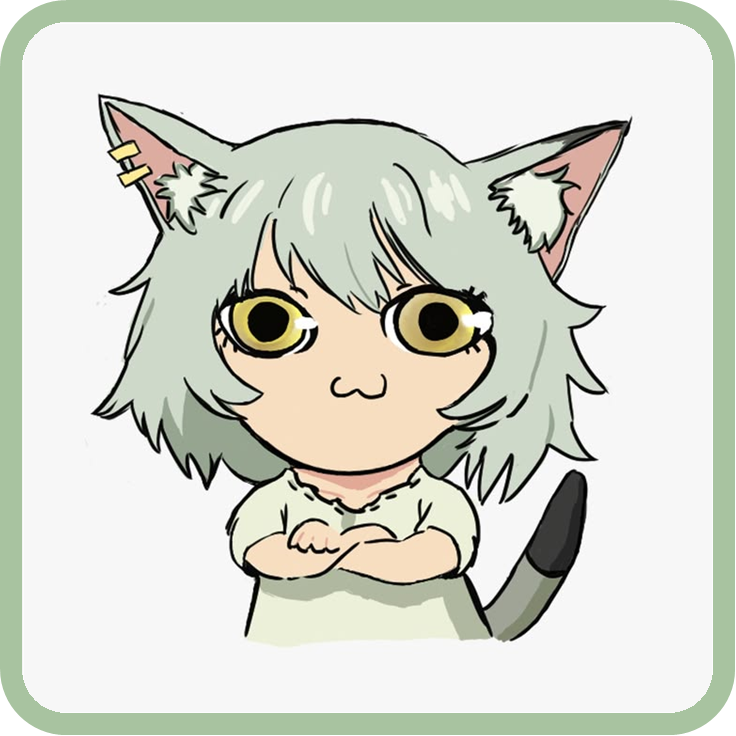
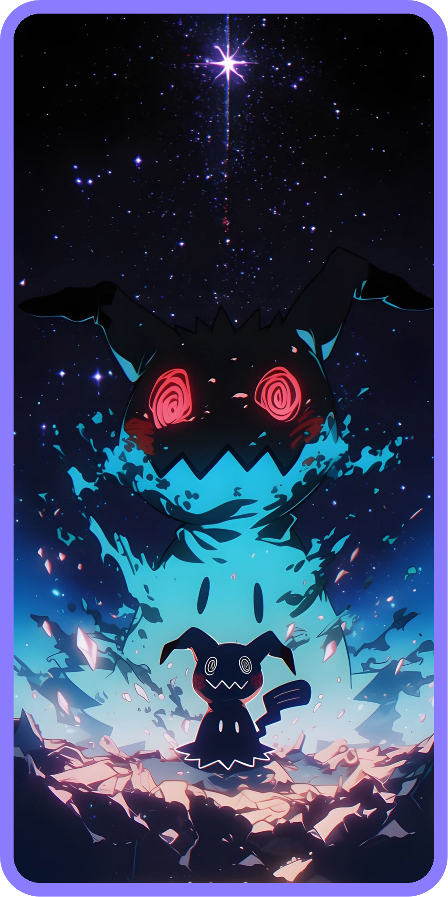
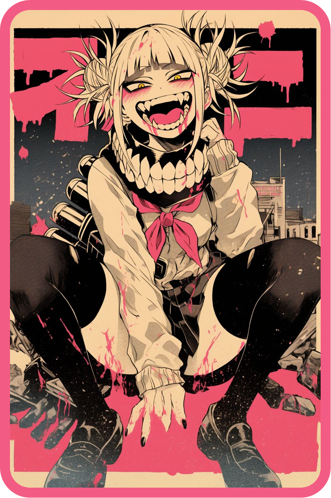

<p align="center">
  <picture>
    <source media="(prefers-color-scheme: dark)" srcset="assets/titulos/nombre-oscuro.svg" />
    
  </picture>
  <br>
  <picture>
    <source media="(prefers-color-scheme: dark)" srcset="assets/titulos/subtitulo-oscuro.svg" />
    
  </picture>
</p>

<br>

<picture>
  <source media="(prefers-color-scheme: dark)" srcset="assets/titulos/sobre-mi-oscuro.svg" />
  
</picture>



Hago cosas con código desde hace poco y me lo paso bastante bien. Casi todo lo que hay por aquí son proyectos míos: unos salen bien, otros no tanto, pero de todos aprendo algo.

Me tira mucho lo que mezcla programación con algo visual o creativo, y si además tiene un toque friki, mejor.

Si te apetece colaborar en algo o simplemente hablar, escríbeme.

<br clear="right">
<br>

<picture>
  <source media="(prefers-color-scheme: dark)" srcset="assets/titulos/pokedex-oscuro.svg" />
  
</picture>

<table>
  <tr>
    <td align="center"><br><sub>#031</sub></td>
    <td>
      <table>
        <tr><td><b>Nº</b></td><td>#031 &nbsp;·&nbsp; Darko31Z</td></tr>
        <tr><td><b>Tipo</b></td><td><code>Código</code> <code>Insomnio</code></td></tr>
        <tr><td><b>Habilidad</b></td><td>En mi máquina funciona</td></tr>
        <tr><td><b>Habilidad oculta</b></td><td>Arregla el bug justo cuando alguien mira</td></tr>
        <tr><td><b>Debilidad</b></td><td>Centrar un div (x4)</td></tr>
        <tr><td><b>Evolución</b></td><td>Junior → Senior a nivel 36 <sub>(requiere mucha cafeína)</sub></td></tr>
      </table>
    </td>
  </tr>
</table>

> *Vive en hábitats oscuros iluminados solo por un monitor. Si lo ves escribiendo rápido a las 3 de la mañana, no lo molestes: está a punto de descubrir que le faltaba un punto y coma.*

<br>

<picture>
  <source media="(prefers-color-scheme: dark)" srcset="assets/titulos/con-que-trabajo-oscuro.svg" />
  
</picture>



Lo que uso casi a diario:

<p>
  
  
  
  
  
</p>

Lo que estoy empollando:

<p>
  
</p>

Idiomas:

<p>
  
  
</p>

<br clear="right">
<br>

<picture>
  <source media="(prefers-color-scheme: dark)" srcset="assets/titulos/ahora-mismo-oscuro.svg" />
  
</picture>

<p align="center"></p>

```
♪ now playing
  World is Mine — Hatsune Miku

  1:42 ━━━━━━━━●─────────── 4:13
        ⇄     ◁◁    ❚❚    ▷▷     ♡

  a continuación:
  01  aprendiendo     →  python
  02  trabajando en   →  proyectitos míos
  03  objetivo        →  pasar a la historia
```

<br>

<picture>
  <source media="(prefers-color-scheme: dark)" srcset="assets/titulos/contacto-oscuro.svg" />
  
</picture>



**¡El entrenador Darío te desafía!**

Para propuestas, dudas o simplemente para hablar de anime, escríbeme. Suelo contestar antes de que Mimikyu se quite el disfraz.

<a href="mailto:ultradario20@gmail.com"></a>

<br clear="right">
<br>

<details>
  <summary><sub>no pulses aquí</sub></summary>
  <br>
  <p align="center">
    ↑ ↑ ↓ ↓ ← → ← → B A<br><br>
    <br>
    <b>¡Un MissingNo. salvaje apareció!</b><br>
    <sub>bueno, era yo. ya que estás aquí: el pastel es mentira y Miku sigue teniendo 16 años.</sub>
  </p>
</details>

<br>

<p align="center"><sub>Darío usó README. ¡Es muy eficaz! &nbsp;·&nbsp; 01</sub></p>
