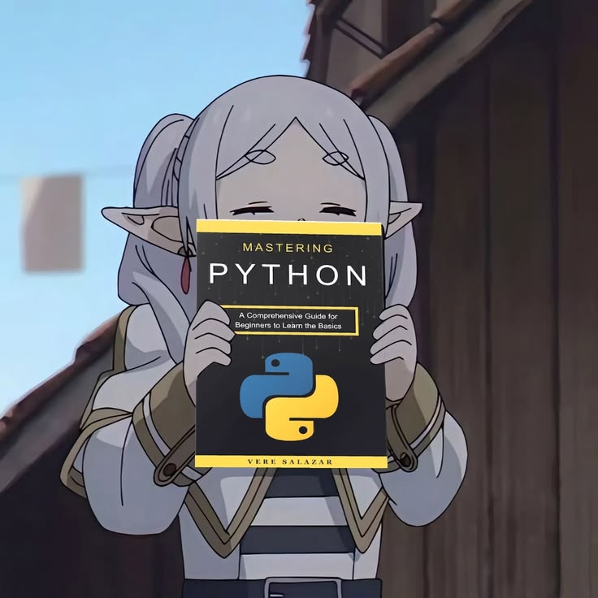

<h1 align="center">Darío Torres</h1>

<p align="center">
  <sub>programador junior &nbsp;·&nbsp; java, web y lo que se ponga por delante &nbsp;·&nbsp; 2D &gt; 3D</sub>
</p>

<br>

### ⋆ sobre mí

Hago cosas con código desde hace poco y me lo paso bastante bien. Casi todo lo que hay por aquí son proyectos míos: unos salen bien, otros no tanto, pero de todos aprendo algo. Me tira mucho lo que mezcla programación con algo visual o creativo.

Si te apetece colaborar en algo o simplemente hablar, escríbeme.

<br>

### ⋆ con qué trabajo

<p>
  
  
  
  
  
  
</p>

<p>
  
  
</p>

<br>

### ⋆ ahora mismo

```
aprendiendo   →  python
trabajando en →  proyectitos míos
objetivo      →  pasar a la historia
```

<br>

<p align="center">
  
  
  
</p>

<br>

### ⋆ contacto

<a href="mailto:ultradario20@gmail.com"></a>

<br><br>

<p align="center"><sub>✦ gracias por pasarte ✦</sub></p>

