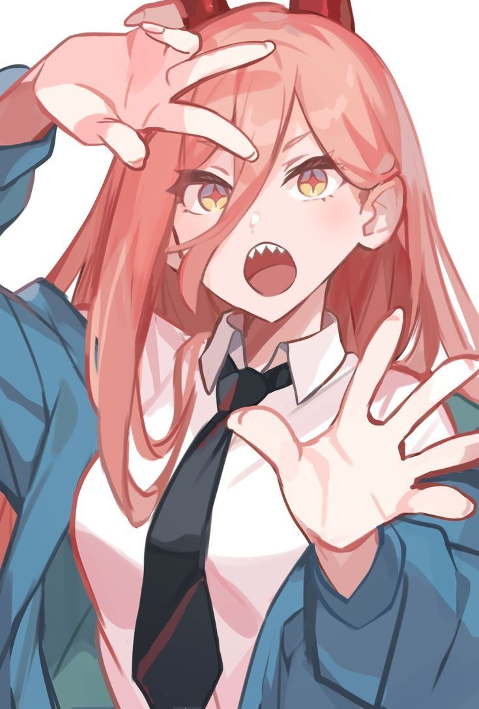
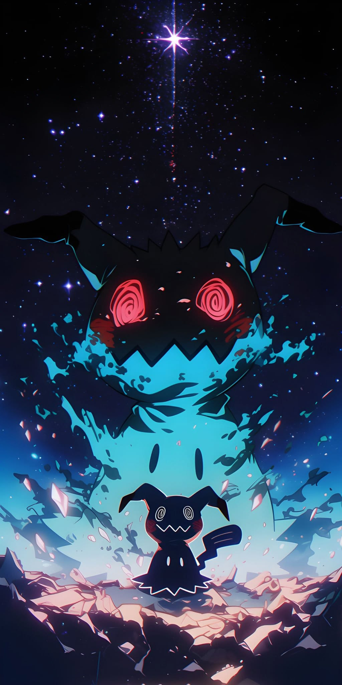
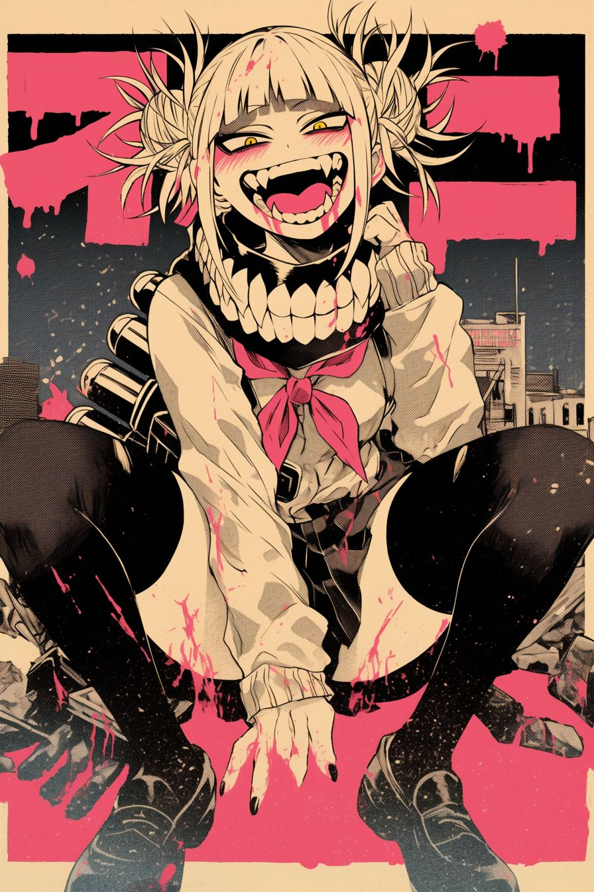

<h1 align="center">Darío Torres</h1>

<p align="center">
  
</p>

<br>

### 🥬 sobre mí


Hago cosas con código desde hace poco y me lo paso bastante bien. Casi todo lo que hay por aquí son proyectos míos: unos salen bien, otros no tanto, pero de todos aprendo algo. Me tira mucho lo que mezcla programación con algo visual o creativo.

Si te apetece colaborar en algo o simplemente hablar, escríbeme.

<br clear="right">
<br>

### 🥬 entrada de la pokédex

<table>
  <tr>
    <td align="center"><br><sub>#031</sub></td>
    <td>
      <table>
        <tr><td><b>Nº</b></td><td>#031 &nbsp;·&nbsp; Darko31Z</td></tr>
        <tr><td><b>Tipo</b></td><td><code>Código</code> <code>Insomnio</code></td></tr>
        <tr><td><b>Habilidad</b></td><td>En mi máquina funciona</td></tr>
        <tr><td><b>Habilidad oculta</b></td><td>Arregla el bug justo cuando alguien mira</td></tr>
        <tr><td><b>Debilidad</b></td><td>Centrar un div (x4)</td></tr>
        <tr><td><b>Evolución</b></td><td>Junior → Senior a nivel 36 &nbsp;<sub>(requiere mucha cafeína)</sub></td></tr>
      </table>
    </td>
  </tr>
</table>

> *Vive en hábitats oscuros iluminados solo por un monitor. Si lo ves escribiendo rápido a las 3 de la mañana, no lo molestes: está a punto de descubrir que le faltaba un punto y coma.*

<br>

### 🥬 con qué trabajo



<p>
  
  
  
  
  
  
</p>

<p>
  
  
</p>

<br clear="right">
<br>

### 🥬 ahora mismo

<p align="center"></p>

```
♪ now playing
  World is Mine — Hatsune Miku

  1:42 ━━━━━━━━●─────────── 4:13
        ⇄     ◁◁    ❚❚    ▷▷     ♡

  a continuación:
  01  aprendiendo     →  python
  02  trabajando en   →  proyectitos míos
  03  objetivo        →  pasar a la historia
```

<br>

### 🥬 estadísticas

<p align="center">
  
  
</p>

<br>

### 🥬 contacto



**¡El entrenador Darío te desafía!**

<a href="mailto:ultradario20@gmail.com"></a>

<br clear="right">
<br>

<details>
  <summary><sub>no pulses aquí</sub></summary>
  <br>
  <p align="center">
    ↑ ↑ ↓ ↓ ← → ← → B A<br><br>
    <br>
    <b>¡Un MissingNo. salvaje apareció!</b><br>
    <sub>bueno, era yo. ya que estás aquí: el pastel es mentira y Miku sigue teniendo 16 años.</sub>
  </p>
</details>

<br>

<p align="center"><sub>Darío usó README. ¡Es muy eficaz! &nbsp;·&nbsp; 01</sub></p>
